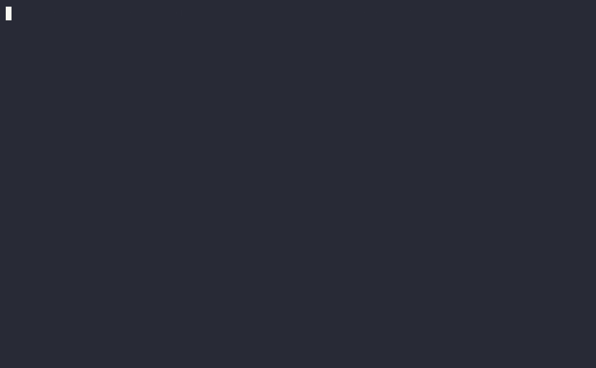
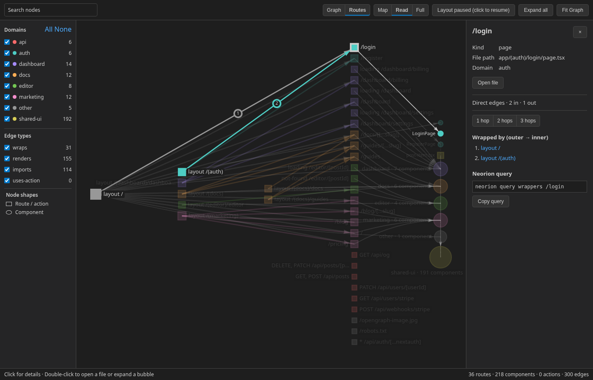

# Neorion

Neorion maps Next.js App Router and Pages Router projects written in TypeScript or JavaScript. Source builds also support React Router v7 Framework Mode and Remix v2. Neorion answers architecture questions deterministically and offline. It shows which layouts and providers wrap a route, which pages render a component, and who calls a server action.



## Real output

Neorion 0.5.2 on [shadcn-ui/taxonomy](https://github.com/shadcn-ui/taxonomy), copied from the terminal:

```text
$ neorion query wrappers /dashboard
Project: taxonomy
# wrappers /dashboard : 3 files, 1 page (index 2026-11-24T13:42Z, fresh)
# not wrappers: rendered inside the page
# providers (outermost first): ThemeProvider, NextThemesProvider (external: next-themes)
1 app/layout.tsx:74 RootLayout
2 components/theme-provider.tsx:7 ThemeProvider providers: NextThemesProvider (external: next-themes)
3 app/(dashboard)/dashboard/layout.tsx:14 DashboardLayout
page app/(dashboard)/dashboard/page.tsx:16
# complete: indexed wrapper chains

$ neorion query who_renders UserAvatar
Project: taxonomy
# who_renders components/user-avatar.tsx#UserAvatar : 3 routes (index 2026-11-24T13:42Z, fresh)
/dashboard  app/(dashboard)/dashboard/page.tsx:16  depth 2 via UserAccountNav [via layout] [cond]
/dashboard/billing  app/(dashboard)/dashboard/billing/page.tsx:25  depth 2 via UserAccountNav [via layout] [cond]
/dashboard/settings  app/(dashboard)/dashboard/settings/page.tsx:14  depth 2 via UserAccountNav [via layout] [cond]
# complete: indexed JSX paths
```

`# complete` covers the indexed static matches in the stated scope. `# partial: <reason>` explains gaps or uncertainty.

## What you can ask

| Kind | Question |
| --- | --- |
| `wrappers` | Which layouts and providers wrap `/dashboard`, outermost first? |
| `who_renders` | Which pages render `UserAvatar`, including through a layout? |
| `api_consumers` | Which files call the `/api/posts` route, or a server action? |
| `rename_impact` | Which files reference `buttonVariants`? |
| `search` | Which components, routes or declarations match `billing`? |
| `impact` | Which routes, server actions, and upstream symbols depend on a symbol or file? |
| `callees` | What does a symbol call, render, or fetch? |
| `path` | What is the shortest directed dependency chain from a page or symbol to a symbol or API route? |
| `changes` | Which symbols, routes, and wrappers are affected by a Git diff? |

Use `--depth <n>` with `impact` and `changes` (default 3, maximum 6). Render paths can continue past that limit. For `callees`, the default is 1 and the maximum is 3. Use `--include-tests` with `impact` to include test files and `--uses` with `callees` to include symbols used as values. Give `path` a source and a destination.

Use `neorion query changes --base <ref>` to compare the worktree against the merge base of `HEAD` and that ref. This includes committed differences and uncommitted edits to tracked files and excludes untracked files. Use `--staged` to compare the index against `HEAD` or `--unstaged` to compare the worktree against the index. The default and `--unstaged` include untracked files and list ignored project-root `.env*` overrides by path as potential configuration changes. Removed files and exports are marked in the result, with importer and route evidence from the comparison side where available.

Add `--limit <n>` to ask for more rows. Output still has a 6,000-byte cap. See the [source-build examples](#build-from-source) for a filtered search and a deeper downstream trace.

In source builds, `api_consumers` uses `[mention]` to mark a reference such as a route literal. `[possible URL override]` marks a transport whose request URL may change at runtime.

The CLI runs on Node.js 18 or later without native modules or Python. CLI queries refresh the graph when needed.

Use it from the CLI, Claude Code, Codex, or the VS Code extension, which also draws an interactive graph that opens source files from their nodes.

## How it compares

The ShareTab tRPC support, index build optimizations, and the agent-query fixes from [PR #23](https://github.com/jaminitachi/Neorion/pull/23) landed after the 0.6.0 release. The sections below identify the measured revisions. [Build from source](#build-from-source) to try the merged changes.

### Native queries

We scored 30 Next.js App Router questions, 10 per app, across rep-deck, ShareTab, and slugy using each tool's CLI directly with no LLM. Graphify 0.9.115 and GitNexus 1.6.12 kept their original scores. Only Neorion was rescored after the original 0.5.2 run. The totals use its impact and path scores from `a70c2a6` and the ShareTab tRPC rerun at `81cd24b`. Its wrapper, renderer and caller scores are from 0.5.2. The tRPC changes landed in [PR #18](https://github.com/jaminitachi/Neorion/pull/18). [Original benchmark method](benchmark/parity/README.md#method)

Slugy was used for development checks. ShareTab's impact and path targets were used to verify tRPC support, so those questions were part of development for that change. Neorion scored 16/20 on rep-deck and ShareTab before the tRPC rerun.

| Apps | Neorion | Graphify | GitNexus |
| --- | ---: | ---: | ---: |
| rep-deck and ShareTab | 18/20 | 11/20 | 8.5/20 |
| All three apps | 27/30 | 17.5/30 | 14/30 |

### Agent mode

Claude Opus 5.5 answered the same six questions per app under each condition. Both evaluations used Graphify 0.9.115 and GitNexus 1.6.12. One scorer graded each app's answers. Both apps ship a `CLAUDE.md`, and the Neorion + Read/Grep/Glob condition added Neorion's setup block to that `CLAUDE.md`. Input tokens include cache usage. Wall time sums the runs for each condition and excludes index setup. Daggerheart Brews ran two cells at a time and Codú ran on a loaded machine, so wall times are approximate.

**Daggerheart Brews (n=1 per cell, Neorion build `a3fed7c`).** These questions later became development data for [PR #23](https://github.com/jaminitachi/Neorion/pull/23).

| Condition | Score | Input tokens | Output tokens | Summed wall time |
| --- | ---: | ---: | ---: | ---: |
| Baseline (Read/Grep/Glob) | 5.5/6 | 532,346 | 15,519 | 148.310 s |
| Neorion + Read/Grep/Glob | 5.5/6 | 357,213 | 10,909 | 389.739 s |
| Neorion only | 2.5/6 | 224,040 | 9,877 | 107.050 s |
| Graphify only | 3.0/6 | 930,428 | 17,388 | 212.526 s |
| GitNexus only | 5.0/6 | 760,579 | 19,391 | 226.820 s |

**Codú (n=2 per cell, Neorion build `25aad09`).** This was the held-out test after that PR. Scores and usage are totals across both runs.

| Condition | Score /12 | Input tokens | Output tokens | Summed wall time |
| --- | ---: | ---: | ---: | ---: |
| Baseline (Read/Grep/Glob) | 11 | 1,625,986 | 37,973 | 625.767 s |
| Neorion + Read/Grep/Glob | 12 | 1,383,121 | 33,022 | 512.302 s |
| Neorion only | 6 | 1,003,839 | 31,788 | 386.770 s |
| Graphify only | 6 | 2,507,437 | 42,301 | 590.648 s |
| GitNexus only | 8 | 2,886,567 | 60,790 | 1,530.491 s |

Neorion-only scored below GitNexus-only on both apps. Neorion alongside Read/Grep/Glob tied the baseline for the highest score on Daggerheart Brews, used fewer input and output tokens than the baseline, and had the longest summed wall time of any condition on that app. It scored highest on Codú.

### Index build time and memory

Across six apps, Neorion's median build time fell by 17.2–43.6% and median peak RSS fell by 4.1–20.6% from `a70c2a6` to `1726869`, the build with the optimizations that landed in [PR #16](https://github.com/jaminitachi/Neorion/pull/16). GNU Time measured fresh index builds on a shared host. The medians include a 55.07 s slugy run before the changes and a 105.90 s ShareTab run after the changes.

Graphify 0.9.115 used one AST-only run per app and different file-selection rules. Its slugy run took 6.08 s in an earlier profile. On Dub, Neorion indexed `apps/web` and Graphify indexed the monorepo root.

| App | Neorion wall (s), before → after | Graphify wall (s) | Neorion peak RSS (KiB), before → after | Graphify peak RSS (KiB) |
| --- | ---: | ---: | ---: | ---: |
| saas-starter | 1.86 → 1.54 | 1.18 | 453,010 → 359,576 | 54,176 |
| taxonomy | 3.92 → 2.835 | 2.17 | 431,704 → 367,560 | 68,016 |
| slugy | 15.185 → 9.325 | 35.94 | 724,852 → 634,188 | 130,992 |
| rep-deck | 5.235 → 3.16 | 3.05 | 512,028 → 435,792 | 75,260 |
| sharetab | 11.31 → 6.375 | 6.38 | 706,092 → 613,260 | 104,060 |
| dub | 18.545 → 10.555 | 18.91 | 924,728 → 886,748 | 187,448 |

Later tRPC tracing (#18) and query fixes (#23) add build time. A fresh ShareTab index build on `master` (`c6f5fb1`) took a median of 7.71 s across three runs in a separate session, so it is not directly comparable to the table.

## Framework support

The table compares route ID, module file, parent, index flag and path against each framework's manifest. The query sample uses one question per query kind on each app.

| App | Framework | Registration matches | Complete without dependencies | Complete with dependencies |
| --- | --- | ---: | ---: | ---: |
| [Indie Stack](https://github.com/remix-run/indie-stack/tree/56abb93bf81f635b574d9ca23eed05602699458a) | Remix v2 | 10/10 | 2/9 | 7/9 |
| [Epic Stack](https://github.com/epicweb-dev/epic-stack/tree/893610db76127fb5a5f1ffa786bee6b050637429) | React Router 7.16 | 49/49 | 0/9 | 5/9 |
| [React Router docs](https://github.com/remix-run/react-router-website/tree/5f1b6fb9016192acfa2d24edfcb2666efd234ff7) | React Router 7.15 | 15/15 | 0/9 | 6/9 |

Missing packages can make source-only results partial. With dependencies installed, partial results still included form props that could change a method or destination, runtime links and redirects, and a diff that reached the query's depth limit. Querying the docs site's dev-only playground registration also reported the runtime route addition.

## Install

Neorion 0.6.0 is not on npm. Install it from the GitHub Release. This installs the `neorion` command, which runs on Node.js 18 or later.

The [benchmark results](#how-it-compares) include source builds made after this release.

```sh
npm install -g https://github.com/jaminitachi/Neorion/releases/download/v0.6.0/neorion-0.6.0.tgz
command -v neorion
```

If the command is missing and you use a custom npm prefix, add its bin directory to your PATH. In a Unix shell, run `export PATH="$(npm prefix -g)/bin:$PATH"`.
When you use the release above, start Claude Code and Codex with `neorion` on PATH.

From your project root, build the graph and ask a question.

```sh
neorion graph
neorion query wrappers /
```

If your app has no `/` route, search for part of a route name with a command such as `neorion query search login`.
In the Pages Router, `wrappers` shows the custom `_app` when present. For dynamic routes, quote
the indexed pattern, such as `'/blog/[slug]'`.

`wrappers` includes third-party components on the page’s wrapper chain and labels
them with their package. Pass `--no-external` in the CLI or set `includeExternal: false`
in MCP to hide third-party non-provider wrappers. Providers stay visible.

`api_consumers` lists caller files and lines for API routes, server actions, and
tRPC procedures. Pass a route URL, `signOut`, or a dotted procedure path such as
`post.create`. Replace example names such as `UserAvatar` and `signOut` with names from
your app. Use `path#Name` to disambiguate a name. tRPC routers must be in the
indexed project. Routers from other workspace packages may be unresolved.

## Codex

Run the following command from the root of your project, then start a new Codex session there.

```sh
neorion setup codex
```

It does three things.

* It installs the Neorion skill in `~/.agents/skills/neorion`.
* It writes a short hint into `./AGENTS.md` in the current folder. The hint tells Codex to query Neorion first for architecture questions and gives the CLI command as a fallback. Setup creates `AGENTS.md` if needed.
* It registers the Neorion MCP server with Codex, or prints the config if Codex is unavailable on PATH.

The Codex and Claude Code hints and skills cover `impact` for upstream callers and affected routes, `callees` for downstream dependencies, `path` for the shortest directed dependency chain, and `changes` for routes and wrappers affected by a Git diff.

The hint sits between `<!-- neorion:start -->` and `<!-- neorion:end -->`. Running the command again replaces that block. Run `neorion setup codex --remove` from the project to clear its block and remove the user-wide skill and MCP registration that setup still owns. Setup recognizes older installations by their released skill and default MCP command. Rerun `--remove` in other projects to clear their blocks, or use `--remove --no-hint` to keep the current project's block. The VS Code extension’s **Connect AI tools** and **Disconnect AI tools** commands manage the same marked block in `AGENTS.md` and `CLAUDE.md`.

Pass `--no-hint` to skip updating `AGENTS.md`, which setup updates only in folders containing `tsconfig.json`, `jsconfig.json`, or `package.json`.

Codex may leave an empty `config.toml` after removal.

## Claude Code

From your project root, run setup once and then start Claude Code as usual.

```sh
neorion setup claude
claude
```

Setup registers the Neorion MCP server at user scope, installs the skill in `~/.claude/skills/neorion/SKILL.md`, and updates the marked block in `CLAUDE.md`. If `CLAUDE_CONFIG_DIR` is set, the skill goes under `$CLAUDE_CONFIG_DIR/skills/neorion/`. If registration fails, setup prints a manual command for your shell (PowerShell on Windows).

Pass `--no-hint` to skip updating `CLAUDE.md`, which setup updates only in folders containing `tsconfig.json`, `jsconfig.json`, or `package.json`.

With Claude Code 2.1.295 or later, setup can add an advisory `PreToolUse` hook for Grep and Glob in the project's `.claude/settings.json`. The hook uses Claude Code's exec-form command arguments and `onFailure` setting. In an indexed Next.js project, it suggests the `neorion_query` MCP tool for likely component, route, or symbol searches, once per target in each session. The search proceeds through Claude's normal permission flow. Use `--no-hook` with older Claude Code versions or to disable the advisory while keeping the other setup features. [Claude Code hooks reference](https://code.claude.com/docs/en/hooks#pretooluse)

Ask “Which layouts or providers wrap the / route?” For headless use, allow the registered tool explicitly.

```sh
claude -p "Which layouts or providers wrap the / route?" --allowedTools mcp__neorion__neorion_query
```

Run `neorion setup claude --remove` from the project to remove the Neorion hook and clear its marked block. It also removes the skill and MCP registration that setup still owns, which unregisters those tools for every project. Run `--remove` in each project to clear its hook and block. Pass `--remove --no-hint` to leave the current project's block in place.

Claude Code may leave its settings file and backups after removal.

For a plugin-only session, launch `claude --plugin-dir "$(npm root -g)/neorion"`. Combining plugin mode with persistent setup makes Claude load two copies of the tool and skill.

## Cursor

From the project root, run `neorion setup cursor`. It configures `.cursor/mcp.json` to launch a pinned Neorion release from GitHub using `npx`, or reuses an existing Neorion MCP entry. If the VS Code extension has already installed an active Neorion rule, Cursor uses that rule. Otherwise, setup writes the same query guidance as the Claude block to `.cursor/rules/neorion-query.mdc`. Cursor applies the rule to every chat in the project. [Cursor MCP configuration](https://cursor.com/docs/mcp#configuration-locations) · [Cursor project rules](https://cursor.com/docs/rules#project-rules)

Run `neorion setup cursor --remove` from the same project to remove the rule block and the MCP entry owned by setup.

## Build from source

Build with Node.js 22 or later.

```sh
git clone https://github.com/jaminitachi/Neorion.git
cd Neorion
NEORION_DIR="$PWD"
npm --prefix extension ci
npm --prefix extension run build:cli
```

1. **App.** Neorion uses the requested directory if it has a `next.config.{js,mjs,ts,cjs}` file
   or declares `next` and has its own routes under `app/`, `pages/`, `src/app/`, or `src/pages/`.
   For example, a root with `next` and `pages/index.jsx` stays at the root.
2. **Monorepo.** A bounded search looks for nested apps with a Next config, a Next dependency, or
   routes and a Next dependency inherited within the checkout. It skips tooling and non-product
   directories such as `test/`, `playgrounds/`, `docs/`, and `website/`. For example, a workspace
   whose sole app is `apps/web` selects that app. With several candidates, Neorion prefers the
   requested directory's TS/JS config, then a candidate's TS/JS config, then a Next dependency,
   in breadth-first alphabetical order. Packages with only a development dependency on Next and
   no routes or Next config are fallback candidates. When stronger candidates exist, the hint lists those.
3. **Library.** With no Next candidate, Neorion uses the first `tsconfig.json` or `jsconfig.json`,
   checking the requested directory first. For example, a library with a root `tsconfig.json`
   and a Next app under `test/` selects the library root. A root that declares `next` and has no
   routes or project config can still be used as a guess.

The `Project:` line shows the full path of the indexed directory. A guess produces
`# partial: project root guessed` and a hint with up to five candidates. VS Code also shows the guess
in its status bar. To confirm a candidate, pass its directory as `--root <dir>` to `query` or `mcp`.
If the selected directory is the current one, use `--root .`. Passing a workspace to `--root` still
discovers its apps if the workspace itself is outside the candidate list. `NEORION_ROOT` follows
the same rule. The Claude plugin and VS Code MCP connections from guessed roots use
`mcp --workspace <dir>` to keep the guess visible in query results.

When indexing JavaScript through `jsconfig.json` or a configless Next.js package,
Neorion uses `allowJs: true` and `checkJs: false`. With default file selection, it skips `node_modules`,
`vendor`, `dist`, `build`, `out`, `coverage`, and `public` at the project root.

```sh
node "$NEORION_DIR/neorion/dist/neorion.cjs" graph
node "$NEORION_DIR/neorion/dist/neorion.cjs" setup codex --local
node "$NEORION_DIR/neorion/dist/neorion.cjs" setup claude
claude
```

These source-build commands list indexed pages, narrow a component search, trace downstream calls and query an indexed route pattern. Replace `ChatShell` and `/blog/[slug]` with a symbol and pattern from your project.

```sh
node "$NEORION_DIR/neorion/dist/neorion.cjs" query search / --kind route
node "$NEORION_DIR/neorion/dist/neorion.cjs" query search chat --kind component --limit 50
node "$NEORION_DIR/neorion/dist/neorion.cjs" query callees ChatShell --depth 2 --limit 84
node "$NEORION_DIR/neorion/dist/neorion.cjs" query wrappers '/blog/[slug]'
```

Run a query from another directory with `--root /path/to/project`. Query suggestions keep the project and CLI invocation. Symbol suggestions show an accepted `path#Name` target and its declaration line.
Add `--mcp-config` to `graph` to print an MCP launcher snippet.
If setup registered absolute paths to Node.js and the CLI, rerun setup when either path changes. This applies to source and packaged builds that use absolute paths.

## VS Code extension



Build with Node.js 22 or later. Use the clone and `NEORION_DIR` from [Build from source](#build-from-source). The extension's build notes describe the dependency warnings that can appear during `npm ci`. [Dependency notes](extension/README.md#build-and-install-locally)

```sh
cd "$NEORION_DIR/extension"
npm ci
npx vsce package
```

In VS Code, run **Extensions: Install from VSIX...** and select the generated `.vsix` file. See the [extension README](extension/README.md) for commands and local tests.

## License

[MIT](LICENSE) © 2026 Tachi Lim (jaminitachi)
