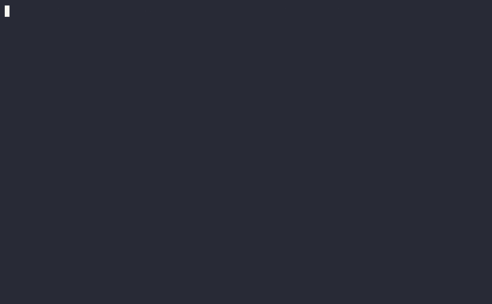

# Neorion



Neorion maps Next.js projects written in TypeScript or JavaScript and answers architecture questions through a CLI or the `neorion_query` MCP tool. The CLI and MCP server store the graph in the local workspace cache. A query builds or refreshes the graph when needed.

## Install

Neorion 0.6.0 is not on npm. Install it from the GitHub Release. This installs the `neorion` command, which runs on Node.js 18 or later.

```sh
npm install -g https://github.com/jaminitachi/Neorion/releases/download/v0.6.0/neorion-0.6.0.tgz
command -v neorion
```

If the command is missing and you use a custom npm prefix, add its bin directory to your PATH. In a Unix shell, run `export PATH="$(npm prefix -g)/bin:$PATH"`.
When you use the release above, start Claude Code and Codex with `neorion` on PATH.

From your project root, build the graph and ask a question.

```sh
neorion graph
neorion query wrappers /
```

If your app has no `/` route, search for part of a route name with a command such as `neorion query search login`.
In the Pages Router, `wrappers` shows the custom `_app` when present. For dynamic routes, quote
the indexed pattern, such as `'/blog/[slug]'`. Add `--limit <n>` to ask for more rows. Output still has a 6,000-byte cap.

`wrappers` includes third-party components on the page’s wrapper chain and labels
them with their package. Pass `--no-external` in the CLI or set `includeExternal: false`
in MCP to hide third-party non-provider wrappers. Providers stay visible.

`api_consumers` lists caller files and lines for API routes, server actions, and
tRPC procedures. Pass a route URL, `signOut`, or a dotted procedure path such as
`post.create`. Replace examples such as `signOut` with names from your app.
In source builds, `[mention]` marks a reference such as a route literal and
`[possible URL override]` marks a transport whose request URL may change at runtime.
Use `path#Name` to disambiguate a name. tRPC routers must be in the
indexed project. Routers from other workspace packages may be unresolved.

## Codex

To register the MCP server and install the skill for Codex, run the following command, then start a new Codex session in your project.

```sh
neorion setup codex
```

The Codex and Claude Code hints and skills cover `impact` for upstream callers and affected routes, `callees` for downstream dependencies, `path` for the shortest directed dependency chain, and `changes` for routes and wrappers affected by a Git diff.

`neorion query changes --depth <n>` uses the same depth range as `impact` (default 3, maximum 6). Use `--base <ref>` to compare the worktree to the merge base of `HEAD` and that ref, including uncommitted edits to tracked files and excluding untracked files.

Run `neorion setup codex --remove` from the project to clear its marked block and remove the user-wide skill and MCP registration that setup still owns. Setup recognizes older installations by their released skill and default MCP command. Rerun `--remove` in other projects to clear their blocks, or use `--remove --no-hint` to keep the current project's block.

Codex may leave an empty `config.toml` after removal.

## Claude Code

From your project root, run setup once and then start Claude Code as usual.

```sh
neorion setup claude
claude
```

Setup registers the Neorion MCP server at user scope, installs the skill in `~/.claude/skills/neorion/SKILL.md`, and updates the marked block in `CLAUDE.md`. If `CLAUDE_CONFIG_DIR` is set, the skill goes under `$CLAUDE_CONFIG_DIR/skills/neorion/`. If registration fails, setup prints a manual command for your shell (PowerShell on Windows).

Pass `--no-hint` to skip updating `CLAUDE.md`, which setup updates only in folders containing `tsconfig.json`, `jsconfig.json`, or `package.json`.

Ask “Which layouts or providers wrap the / route?” For headless use, allow the registered tool explicitly.

```sh
claude -p "Which layouts or providers wrap the / route?" --allowedTools mcp__neorion__neorion_query
```

Run `neorion setup claude --remove` from the project to clear its marked block. It also removes the skill and MCP registration that setup still owns, which unregisters those tools for every project. Blocks in other projects stay until you run `--remove` there. Pass `--remove --no-hint` to leave the current project's block in place.

Claude Code may leave its settings file and backups after removal.

For a plugin-only session, launch `claude --plugin-dir "$(npm root -g)/neorion"`. Combining plugin mode with persistent setup makes Claude load two copies of the tool and skill.

## Build from source

Build with Node.js 22 or later.

```sh
git clone https://github.com/jaminitachi/Neorion.git
cd Neorion
NEORION_DIR="$PWD"
npm --prefix extension ci
npm --prefix extension run build:cli
```

From your project root, run the CLI directly from the clone. Neorion keeps the requested directory
when it has routes and either declares `next` or inherits `next` from an ancestor `package.json` in
the same Git checkout. Discovery looks for `page`, `layout`, `route`, and supported metadata files
under `app` or `src/app`, and page or API files under `pages` or `src/pages`. A requested directory
with a `tsconfig.json` or `jsconfig.json` of its own also stays selected when it does not declare
`next`. Otherwise, a workspace root searches for routed members in the same Git checkout.
Members need a valid `package.json` and must match the patterns in
`pnpm-workspace.yaml` or `package.json#workspaces`. Exclusions apply regardless of pattern order.
Without a workspace declaration, a root that declares `next` searches for routed descendants,
including apps without a manifest. A root that declares `next` stays selected if the search finds
no routed app.

Discovery treats `cypress`, `e2e`, `integrations`, `playwright`, `scripts`, `test`, `tests`,
`example`, `examples`, `demo`, `demos`, `samples`, `playground`, and `playgrounds` as fallback
locations among Next.js projects. The generic fallback can discover projects in nested Git
checkouts. Without Next.js candidates, the first config in breadth-first order wins.

When indexing JavaScript through `jsconfig.json` or a configless Next.js package, Neorion uses
`allowJs: true` and `checkJs: false`. With default file selection, it skips `node_modules`, `vendor`,
`dist`, `build`, `out`, `coverage`, and `public` at the project root.

```sh
node "$NEORION_DIR/neorion/dist/neorion.cjs" graph
node "$NEORION_DIR/neorion/dist/neorion.cjs" setup codex --local
node "$NEORION_DIR/neorion/dist/neorion.cjs" setup claude
claude
```

These source-build commands list indexed pages, narrow a component search, trace downstream calls and query an indexed route pattern. Replace `ChatShell` and `/blog/[slug]` with a symbol and pattern from your project.

```sh
node "$NEORION_DIR/neorion/dist/neorion.cjs" query search / --kind route
node "$NEORION_DIR/neorion/dist/neorion.cjs" query search chat --kind component --limit 50
node "$NEORION_DIR/neorion/dist/neorion.cjs" query callees ChatShell --depth 2 --limit 84
node "$NEORION_DIR/neorion/dist/neorion.cjs" query wrappers '/blog/[slug]'
```

Run a query from another directory with `--root /path/to/project`. Query suggestions keep the project and CLI invocation. Symbol suggestions show an accepted `path#Name` target and its declaration line.
Add `--mcp-config` to `graph` to print an MCP launcher snippet.
If setup registered absolute paths to Node.js and the CLI, rerun setup when either path changes. This applies to source and packaged builds that use absolute paths.
